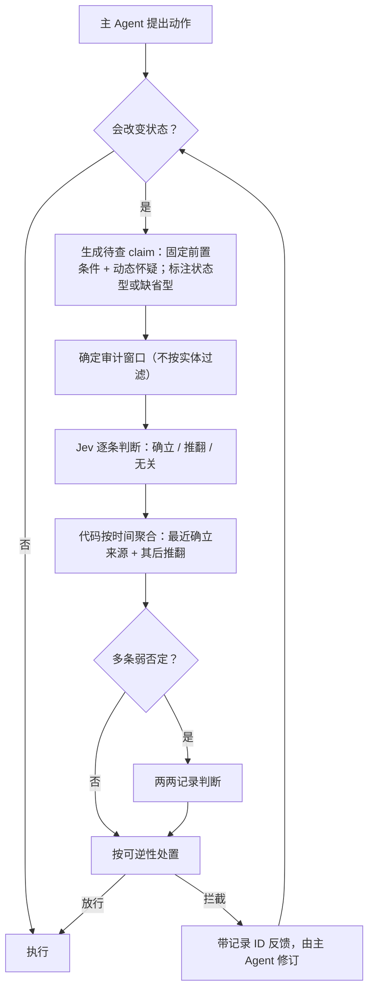

# 动作前核查中的时间顺序分解：有序逐条审计 vs 整体判断 vs 无序拆分

**文档类型：方法设计草案 v0.4（由 v0.3 修订）**  
**日期：2026-11-24**  
**状态：设计阶段。文中的机制、预测和阈值均为提议，尚未实现或运行；文中示例为构造示例，除非注明来源。**

## 0. v0.4 改了什么

v0.3 的复审指出：“按记录拆开判断有帮助、但需要组合多条记录时失效”这一边界，在相邻领域已经被报告过（SummaC 的逐句 NLI 判断；2610.36308 关于过时竞争陈述的干扰）。v0.4 因此把“拆开判断”分成三个可以分别测量的成分，并把贡献放在前人没有覆盖的两个成分上。

| ID | v0.3 的问题 | v0.4 的处理 |
|---|---|---|
| N1 | 核心预测与 SummaC、2610.36308 重叠 | 核心改为**时间顺序**：claim 可能被推翻后又被重新确立；新增不考虑顺序的拆分对照 U1，用 D1 − U1 测量顺序本身的效应（§2、§6） |
| N2 | 组合风险触发条件（≥2 条同实体记录）与“干扰多时拆分有利”的预测互相抵消 | 触发条件改用逐条判断给出的弱否定信号；补救改为两两记录判断，不再退回整体判断（§3.4） |
| N3 | 间接推翻被列为拆分有利，但按实体检索会漏掉这些记录 | 默认对审计窗口内全部记录做判断，不按实体过滤；实体过滤作为省成本变体单独测召回（§3.3） |
| N4 | 缺少“先逐条抽取、再由代码跟踪”的对照 | 新增 E1，并提出“带着条件判断”优于“事先抽取”的理由和预测（§2.3、§6） |
| N5 | “某事没有发生”类条件没有正向来源，永远是 UNKNOWN | 区分状态型与缺省型 claim，缺省型在记录完整时可判为缺省成立（§3.2） |
| C1 | 主环境未定，τ²-bench airline 已被证明很多违规可由规则门控查出 | 选环境的检查加入“顺序敏感 claim 的自然出现率”；τ²-bench 降为待检查候选（§5） |

v0.3 中保留不变的部分：只改变一个变量的核心对比、按可逆性处置、强 LLM 接管作为可选扩展、防泄漏规则和 presence-only 基线。

## 1. 研究问题

Agent 在执行会改变状态的动作前，需要确认动作依赖的条件现在仍然成立。很多这类条件的真值取决于**记录的先后顺序**：

- 用户先要求取消预订，随后说“先别取消”，几轮之后又说“还是取消吧”；
- 一个文件被移走，后来又被恢复；
- 一项权限被撤销，后来又被重新授予。

在这类历史里，一条推翻记录本身并不决定当前状态；决定当前状态的是**最后一条相关记录**。

**核心问题：对于冻结的单次前向决策模型（Jev/Kev 类），在动作前核查中，按时间顺序做“最近确立来源 + 其后逐条 delta”的审计，是否在顺序敏感的 claim 上优于 (a) 整体读完历史再判断、(b) 拆开但不考虑顺序的逐条判断、(c) 先逐条抽取状态再由代码跟踪？**

这是原论文 *Where Decomposition Stops* 在动作前核查上的延伸，但问题的焦点从“拆不拆”换成了“拆开以后，顺序和条件化各自贡献了什么”。

## 2. 拆开判断的三个成分

v0.3 把“逐条分解”当成一个整体。v0.4 把它分成三个成分，每个成分都有一个只差这一点的对照：

| 成分 | 含义 | 已有工作 | 对照 |
|---|---|---|---|
| 拆分 | 模型每次只看一条记录 | SummaC：逐句 NLI 判断后取最大值，优于整篇输入；多句组合时失效 | H2（同一批记录拼成一个上下文） vs U1 |
| 顺序 | 聚合时按时间顺序，较晚的确立记录覆盖较早的推翻记录 | SummaC 是静态蕴含，不涉及顺序；原 EDA 草稿在记忆审计中使用了顺序，但没有单独测量它的效应 | U1 vs D1 |
| 条件化 | 判断时带着待查 claim，而不是事先抽取一份通用状态 | StateAuditor、TEPA 等按 key 存储并撤销旧记录，属于先抽取后跟踪 | E1 vs D1 |

“拆分”这一成分的效应预计会重现已有结论，本文不把它作为贡献，只作为复现检查。贡献主张放在**顺序**和**条件化**上。

### 2.1 为什么顺序重要：一个最小反例

构造示例（非真实轨迹）。拟议动作：`cancel_reservation(R123)`。claim：“用户当前要求取消 R123”。

```text
r2：用户：帮我取消 5 月 3 日的预订 R123。
r6：用户：等等，先别取消，我再想想。
r11：用户：好，还是取消吧。
```

- **D1（有序）**：从最新记录往前找最近的确立来源，找到 r11；r11 之后没有记录 → `SUPPORTED`。
- **U1（无序取最大值）**：r6 对 claim 的否定分数最高 → `CONTRADICTED`，误拦截。
- **H2（整体）**：结果取决于模型能否在一次前向中正确比较三条记录的先后；这正是待测的。

把 r11 删掉，正确答案变成 `CONTRADICTED`，D1 和 U1 都能判对。所以 D1 − U1 的差异只会出现在**推翻后又重新确立**（或确立后被推翻、再次确立）的样本上。这给出了一个清楚的可区分预测（§6.2 P1）。

### 2.2 为什么整体判断可能在顺序上出错

单次前向的小决策模型需要在一个上下文里同时完成三件事：找出所有相关记录、确定它们的先后、取最后一条的极性。2610.36308 报告过：在记忆问答中，多加一条过时的竞争陈述，比多加一条无关陈述伤害更大。推翻—重新确立链正好制造了多条互相竞争、彼此只差时间的陈述。有序审计把“确定先后、取最后一条”交给代码，模型每次只回答“这一条记录对 claim 是确立、推翻还是无关”。

### 2.3 为什么条件化可能重要

先抽取后跟踪（E1）必须事先决定抽哪些属性。固定前置条件（来自工具说明）可以事先列出，E1 应当表现良好；但动态怀疑常常针对事先没想到的属性，例如“用户是否说过只在周末出发”。如果抽取阶段没有抽出这个属性，代码跟踪就无从判断。D1 带着具体 claim 去读每条记录，不需要事先知道哪些属性重要。

这推出第二个可区分预测：D1 − E1 的差距在**动态怀疑**上大于在**固定前置条件**上（§6.2 P2）。

### 2.4 有序审计会在哪里失效

- **组合型推翻**：需要两条以上记录合起来才构成推翻。构造示例：r4“清理任务会删除标为 draft 的文件”；r7“report.pdf 被标为 draft”。单看任何一条，“report.pdf 仍在原位置”都可能成立。§3.4 的两两判断针对这种情况。
- **相对时间与隐含顺序**：记录的物理顺序与其描述事件的发生顺序不一致（例如“我昨天已经取消过了”出现在较晚的记录里）。有序审计按记录顺序聚合会出错，整体判断反而可能理解。这种样本单独标注、单独报告。
- **presence 捷径**：原草稿 §6.4 发现“来源之后是否还有相关记录”本身就有预测力。需要在匹配子集上检验（§6.2 P5）。

## 3. 方法：有序 Action-EDA 核查器

### 3.1 流程



### 3.2 claim 的来源与类型

- **固定前置条件**：从公开工具说明得出，每次都检查。
- **动态怀疑**：由 LLM 根据任务、历史和拟议动作生成，最多 K 条，每条绑定到动作中的具体实体或参数。

每个 claim 标注类型：

| 类型 | 例子 | 无相关记录时 |
|---|---|---|
| 状态型 | “订单 R123 的状态是待处理” | `UNKNOWN`（需要正向来源） |
| 缺省型 | “用户没有撤回该请求”“该文件没有被删除” | 若审计窗口覆盖完整（例如整段对话都可见），判为 `SUPPORTED_DEFAULT`；否则 `UNKNOWN` |

`SUPPORTED_DEFAULT` 与 `SUPPORTED` 分开统计，便于检查缺省规则带来的误放行。类型由生成器标注，再由模板规则校验（例如含“没有/未/仍未”且指向事件的 claim 归为缺省型）；无法判定类型时按状态型处理。

**同一组 claim 交给所有对照方法**，因此生成器的盲点不会混淆方法间的比较。生成器的覆盖率单独测量。

### 3.3 审计窗口

v0.3 用按实体检索的子集，会漏掉间接推翻。v0.4 默认：

- 状态型：从任务开始到当前的全部记录，从最新往前找最近的确立来源，然后审计来源之后的全部记录；
- 缺省型：从任务开始到当前的全部记录。

不按实体过滤。调用次数随历史长度线性增长；同一 claim 的多条记录判断可以共享前缀，具体能否批处理取决于 Jev 接口。**实体过滤**保留为省成本变体 D1-f，单独报告它在间接推翻样本上的召回损失。

### 3.4 逐条判断、有序聚合与两两补救

**逐条判断。**每次调用给 Jev 一条记录、一个 claim 和必要的公开动作语义，问一个三选项问题：

```text
这条记录对 claim 的作用是：
A. 确立（该记录之后 claim 成立）
B. 推翻（该记录之后 claim 不成立）
C. 无关或单凭这条记录无法判断
```

若接口只稳定支持二选项，则拆成原 EDA 的 Q-source 和 Q-delta 两个问题，并在文档中注明适配。

**有序聚合（代码）。**按时间顺序扫描：

- 记录 A（确立）和 B（推翻）的位置与分数；
- 当前状态取**最后一条非无关记录**的极性；
- 若没有非无关记录：状态型 → `UNKNOWN`，缺省型 → 按 §3.2 处理；
- 最后一条非无关记录的分数低于阈值，或最后两条极性相反且分数接近 → `UNKNOWN`。

这与原 EDA“从最新往前找来源、审计来源之后的 delta”在推翻—重新确立链上的结果一致，但把“确立”和“推翻”放进同一个问题里，便于和 U1 对比。原 EDA 的 `max(-log-odds)` 聚合作为 Q0 对照保留。

**两两补救（针对组合型推翻）。**v0.3 用“≥2 条同实体记录”触发整体判断，这恰好覆盖了干扰多、拆分本该有利的样本。v0.4 改为：

- **触发条件**：最后一个确立来源之后，有 ≥2 条记录被判为“无关”，但它们的推翻分数处于 [τ_low, τ_high) 区间（单看不足以推翻，但并非毫无关系）。纯干扰记录预计分数接近 0，不会触发。
- **补救动作**：对这些记录按时间两两组合，问 Jev“这两条记录合起来，是否使 claim 在后一条之后不成立”。组合数设上限 M。
- **合并**：两两判断得到的推翻，视为发生在两条记录中较晚的那一条，再参与有序聚合。

τ_low、τ_high 和 M 在开发集固定。触发率单独报告；如果在纯干扰样本上触发率很高，说明该信号没有区分组合与干扰。

### 3.5 按可逆性处置

动作的可逆性从公开工具说明中标注一次。

| 聚合结果 | 可逆动作 | 不可逆动作 |
|---|---|---|
| `CONTRADICTED` | 拦截，引用记录 ID 反馈给主 Agent 修订 | 同左 |
| `UNKNOWN` | 放行，依赖执行后反馈 | 先做一次只读查询（若环境提供）；仍未知则拦截并反馈 |
| `SUPPORTED` / `SUPPORTED_DEFAULT` | 放行 | 放行 |

修订后的动作重新进入核查；预算用完时的处置在开发集固定，单独统计。

### 3.6 可选扩展（不属于核心对比）

- 强 LLM 接管：在 `CONTRADICTED` 后由更强模型提出替代动作；与 LoopRoute 式接管对照，核心对比完成后再报告。
- Jev 对 claim 排序以节省调用：只有当它改变检查集合时才有意义。

## 4. 与最接近工作的差异

文献覆盖：BlackSwan、JevAct、LoopRoute 读了 §3–4（原文都只读了前半部分）；SummaC 读了全文；2610.36308、2608.01619、2608.07429、2607.07405 只读了 arXiv 摘要；JevAgentHarness、ReDAct、EOCV 没有重新核实。检索用的是 arXiv 搜索页，属于部分检索。

| 工作 | 已有机制 | 与 v0.4 的关系 |
|---|---|---|
| BlackSwan (2611.02950) | 对写操作生成与代码元素绑定的怀疑，在一个多轮循环中结合历史与只读探测整体判定；ALFWorld unseen 99.5% | 动态怀疑的生成借鉴它；G1 对照即 BlackSwan 式整体核查 |
| JevAct (2610.38620) | 写调用前触发；Kev 单次前向给出选项概率；代码从工具记录中抽取事实；同一 LLM 带反馈修订 | 冻结决策模型 + 执行前门控已被覆盖；它的 Kev 读完整对话，不做有序逐条审计 |
| SummaC (2111.09525) | 逐句 NLI + 最大值聚合，优于整篇输入；§5.3.3 指出多句组合时逐句判断失效 | “拆分”成分及其组合失效已被它覆盖；U1 即 SummaC 式对照。它不涉及时间顺序 |
| When Retrieval Is Not Enough (2610.36308) | 记忆问答中，过时的竞争陈述比无关陈述伤害更大 | 支持 §2.2 的动机；它研究的是检索与使用，不是动作前核查的聚合方式 |
| StateAuditor (2608.01619)、TEPA (2608.07429) | 按 key 存储记录，代码检查新证据是否更新，撤销旧记录 | E1 对照的来源；它们是先抽取后跟踪，不带着待查 claim 判断 |
| Reason Less, Verify More (2607.07405) | 执行前确定性规则门控；τ²-bench airline 上 gpt-4o-mini 成功率 29.6% → 42.0% | 说明 τ²-bench 中大量违规可被规则查出，影响环境选择（§5） |
| LoopRoute (2611.25363) | Jev 主控 + 重复触发的 LLM 有限接管；ALFWorld | 只与 §3.6 可选扩展相关 |
| 原 EDA 草稿 | 记忆审计中的来源—delta 逐条判断 | v0.4 把它移到动作前，并把顺序、条件化两个成分分离出来单独测量 |

**贡献主张：**

1. 在动作前核查中，分离并测量“顺序”和“条件化”两个成分的效应，指出它们在哪类 claim 上起作用。
2. 一个有序、带条件、能处理缺省型 claim 和组合型推翻的核查器。

“生成怀疑 + 执行前核查 + 修订”的主干、以及“拆分有帮助但组合时失效”的一般现象，都不作为本文的创新主张。

## 5. 环境选择

### 5.1 主环境需要满足的条件

在少量自然轨迹上逐项检查：

1. **T0 判定不了的 claim 足够多**：基于结构化字段的确定性跟踪器无法判定的待查 claim 占比。2607.07405 的结果提示 τ²-bench airline 上这一比例可能偏低，需要先测。
2. **顺序敏感样本自然出现**：至少存在一类自然出现的推翻—重新确立链（用户改主意、对象被移走后恢复、状态被回滚等）。这是核心主张的适用范围；如果自然轨迹中几乎没有，核心主张即使成立，实际意义也有限。
3. **存在不可逆写操作**，执行前拦截有实际价值。

### 5.2 候选

- **AppWorld**：API 历史长，写操作改变应用状态；需检查用户/环境是否会在一个任务内回滚状态。
- **τ²-bench**：用户可以在对话中改变请求，写操作不可逆；先过 5.1 第 1 条，若规则门控已能覆盖大部分 claim，则只用其中顺序敏感的子集。
- **以自然语言记录为主、包含撤回或改变主意的对话环境**：可从带时间戳更新的记忆基准（如 2608.01619 使用的 STALE、2610.36308 使用的 MemoryAgentBench FactConsolidation）构造“动作需要事实 X”的核查样本。这类样本是构造的，与自然 agent 轨迹分开报告。

### 5.3 ALFWorld 作为负对照

位置、持有等状态完全由 agent 自己的动作决定且被记录，T0 应接近上限。预测：D1、U1、H2 都不显著优于 T0。

### 5.4 诊断集标注维度

对每个 (claim, 历史前缀) 样本标注：

- claim 类型（状态型 / 缺省型）与来源（固定前置条件 / 动态怀疑）；
- 是否顺序敏感（存在推翻后再确立，或确立后推翻）；
- 推翻是否需要组合 ≥2 条记录；
- 推翻是否直接提到实体或谓词；
- 记录顺序与事件顺序是否一致（§2.4 的隐含顺序）；
- 来源距离、窗口内记录数、同实体记录数。

自然样本中稀少的格子可以用受控插入补足，插入样本单独报告，不计入自然发生率。

## 6. 证据计划

### 6.1 对照方法

所有方法使用同一个 Jev、同一组 claim、同一历史前缀。

| 编号 | 方法 | 用途 |
|---|---|---|
| H1 | Jev 读完整历史，对每个 claim 做一次判断 | 整体判断 |
| H2 | Jev 读 D1 实际判过的同一批记录，拼成一个上下文，做一次判断 | 与 D1 信息完全相同的整体判断 |
| U1 | 逐条判断（同 §3.4 的三选项），聚合时不看顺序：任一记录的推翻分数超过阈值即判 `CONTRADICTED`，否则看是否存在确立记录（与 SummaC 及原 EDA 的取最大值一致） | SummaC 式无序拆分 |
| E1 | 每条记录用 LLM 抽取一次 (实体, 属性, 值)，代码按“最新为准”跟踪；再由 LLM 把 claim 映射到 key 并查表 | 先抽取后跟踪（StateAuditor/TEPA 式） |
| D1 | 有序逐条审计（§3.3–3.4，不含两两补救） | 本方法核心 |
| D1-f | D1 + 按实体过滤审计窗口 | 省成本变体，测召回损失 |
| D2 | D1 + 两两补救 | 完整核查器 |
| T0 | 只用结构化字段的确定性跟踪器 | 检验 claim 是否真的需要模型 |
| P0 | Presence-only | 检验 presence 捷径 |
| G1 | BlackSwan 式生成式整体核查 | 生成式参照 |
| Q0 | 原 EDA：Qwen3-4B 单 token 读出 + `max(-log-odds)` | 原方法参照 |

关键差值：

- H2 − U1：拆分的效应（预计复现 SummaC 方向，不作为贡献）；
- **D1 − U1：顺序的效应**；
- **D1 − E1：条件化的效应**；
- D2 − D1：两两补救的效应；
- D1 − D1-f：实体过滤的召回代价。

### 6.2 可区分的预测

- **P1（顺序）**：在顺序敏感样本上，D1 > U1 且 D1 > H2；在顺序不敏感样本上，D1 ≈ U1。
- **P2（条件化）**：D1 − E1 在动态怀疑上大于在固定前置条件上；在固定前置条件上 E1 可能与 D1 持平。
- **P3（组合）**：在组合型推翻样本上 D1 失败、D2 恢复；在纯干扰样本上 D2 的触发率低，D2 ≈ D1。
- **P4（负对照）**：在 ALFWorld 上 T0 接近上限，D1、U1、H2 都不显著优于 T0。
- **P5（presence）**：在按来源后记录数、实体、谓词、历史长度匹配的子集上，P1 仍然成立。
- **复现检查**：H2 与 U1 的方向与 SummaC、2610.36308 一致；若不一致，需要解释，但不影响 P1、P2 的判定。

**核心主张不成立的条件**：顺序敏感样本上 D1 不优于 U1 和 H2（P1 不成立），或者 P1 只在未匹配样本上成立（P5 不成立）。P2 不成立时，条件化这一贡献撤回，顺序这一贡献仍可单独成立。

### 6.3 在线影响（次要）

把核查器接入主 Agent（Qwen3.5-4B），比较无核查、H1、U1、D2 和 G1。指标：任务成功率；不可逆动作中错误被拦截的比例；误拦截率（尤其是顺序敏感样本上的误拦截，例如 §2.1 中 U1 的错误）；调用数、token、墙钟时间、美元成本。环境支持确定性回放时，在同一前缀上分支比较，把“证据反馈”与“多采样一次”区分开。

### 6.4 沿用的规则

- 核查器只看执行前可见信息：任务、当前观察、已发生的历史、公开工具说明、拟议动作；不看隐藏状态、未来反馈或最终结果。
- 按 episode/任务分组划分开发与测试，做 bootstrap。
- Jev、Kev 与 Qwen 单 token 读出分别命名；三选项或二选项能力在 smoke test 中确认。

## 7. 继续 / 转向条件

- **继续**：主环境通过 §5.1 的三项检查，且 P1 在自然样本的匹配子集上成立。
- **收窄**：P1 成立，但顺序敏感样本在自然轨迹中很少 → 把贡献表述为“针对特定历史结构的诊断发现”，而不是通用核查器。
- **转向**：P1 不成立 → 顺序在动作前核查中没有带来超出无序拆分的收益，这是一个可报告的负结果，直接回答“分解在哪里停止”。若 P2 成立，可把贡献转为条件化。
- **实验条件未满足**：自然样本过少、接口不支持所需读出、回放失败。这些只说明结论尚不确定。

## 参考来源

1. 用户论文草稿 *Where Decomposition Stops: Auditing Stale Agent Memory with One-Pass Decision Models*，§4.2、§5、§6.4。
2. Oh et al., *Action Verification through Conjecture and Refutation for Language Model Agents* (BlackSwan), arXiv 2611.02950，§3、Table 2、附录 A–B。
3. *Think Before You Act: Decision Gate for LLM Agents* (JevAct), arXiv 2610.38620v1，§3–4。
4. *Stop Going in Circles: Loop-Triggered Routing for System 1 Decision Agents* (LoopRoute), arXiv 2611.25363v1，§3–4。
5. Laban, Schnabel, Bennett, Hearst, *SummaC: Re-Visiting NLI-based Models for Inconsistency Detection in Summarization*, TACL 2022, arXiv 2111.09525，图 1、§5.3.3、§6、附录 B。
6. *When Retrieval Is Not Enough: Obsolete Facts in Agent Memory*, arXiv 2610.36308（摘要）。
7. *When Memory Updates but Behavior Does Not: Repairing Implicit Stale Dependencies in Personalized Agent Responses* (StateAuditor), arXiv 2608.01619（摘要）。
8. *TEPA: Revoking Stale Memories for Conflict-Robust Language Agents*, arXiv 2608.07429（摘要）。
9. *Reason Less, Verify More: Deterministic Gates Recover a Silent Policy-Violation Failure Mode in Tool-Using LLM Agents*, arXiv 2607.07405（摘要）。
10. v0.2 中列出的 JevAgentHarness、ReDAct、EOCV、ReAct、ALFWorld 来源（本版未重新核实）。
